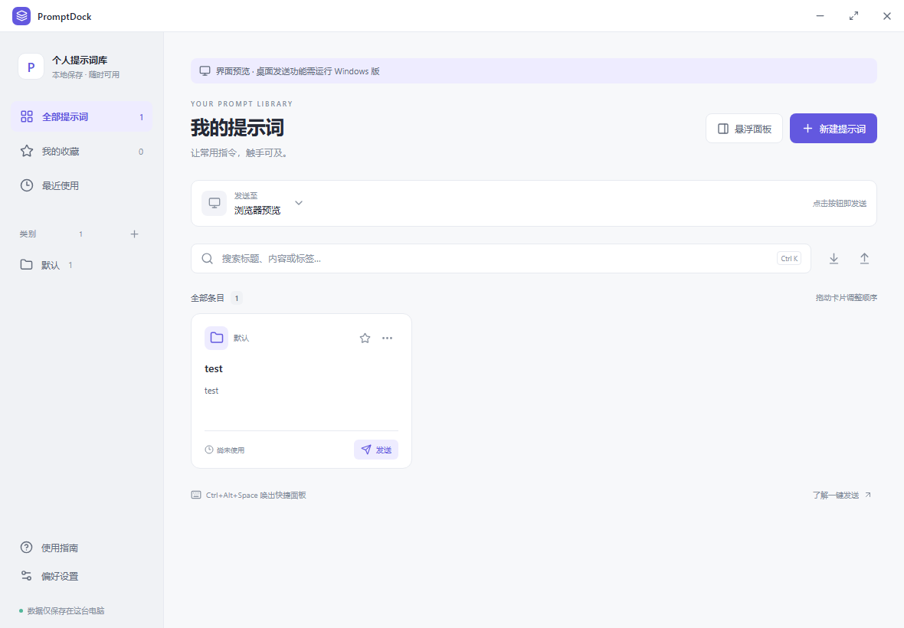

# PromptDock

> **自动适配大部分主流对话式 AI 应用**，自动查找输入框，一键填入或发送常用提示词。适用场景包括网页端（GPT、Gemini、DeepSeek）、桌面端（Codex、Cherry Studio）及 VS Code 插件（Claude Code）等。具体适配效果取决于目标应用是否向 Windows 暴露可识别的输入框。

面向 Windows 的轻量本地提示词管理器，使用 **Tauri 2 + Vue 3 + TypeScript + Rust** 开发。

保存常用提示词，在置顶面板中点击按钮，即可向所选桌面应用的输入框填入内容或触发发送。提示词库保存在本地，无需模型 API 密钥。



## 功能

- 提示词新增、编辑、复制、删除、搜索、收藏和拖动排序。
- 独立的类别管理；空类别可保存，删除类别后条目移入“默认”。
- `{{变量}}` 模板、JSON 导入合并 / 替换、导出及自动备份。
- 管理窗口、置顶悬浮面板、系统托盘和全局快捷键。
- 自动识别目标输入框，支持仅填入、复制、Enter / Ctrl+Enter 发送。
- 浅色、深色和跟随系统主题。

初始库只有“默认”类别和一条 `test` 提示词。

## 开发环境

- Windows 10 / 11 x64，Microsoft Edge WebView2 Runtime。
- Node.js 20.11 或更新的受支持版本，及 npm。
- Rust stable 的 MSVC 工具链。本项目已使用 Rust 1.99.1 编译。
- Visual Studio Build Tools 的“使用 C++ 的桌面开发”，包含 Windows SDK。

安装要求见 [Tauri 官方前置条件](https://v2.tauri.app/start/prerequisites/)。

## 本地运行

在仓库根目录执行：

```powershell
npm ci
npm run dev:desktop
```

也可以双击 `scripts/dev.cmd`。

只预览界面时运行 `npm run dev`，然后打开终端显示的本地地址。浏览器预览支持管理和复制提示词，无法控制其他桌面应用。

## 测试与构建

```powershell
npm run build
npm test
npm run test:rust
npm run build:desktop
```

`build:desktop` 会先构建前端，再生成 `src-tauri/target/release/prompt-dock.exe`。也可以双击 `scripts/build-windows.cmd` 完成测试和构建。

如需 NSIS 安装包，运行 `npm run tauri build`；输出位于 `src-tauri/target/release/bundle/nsis/`。首次打包可能需要下载 NSIS。

两个依赖锁文件均保留在仓库中。具体检查记录和手动验收步骤见 [验证说明](docs/VALIDATION.md)。

## 使用

1. 打开目标聊天，在“发送至”中选择对应窗口。
2. 打开悬浮面板，或使用默认快捷键 `Ctrl+Alt+Space` 唤出。
3. 点击提示词按钮；程序会自动查找并聚焦输入框、粘贴内容，再按所选方式处理。
4. 如目标应用使用 `Ctrl+Enter` 发送，在偏好设置中更改。

输入框被目标应用重建后会自动重新识别，无需手动绑定。发送按普通粘贴行为处理已有文字和选区，不检查草稿；保留在输入框中的其他文字可能一起发送。焦点变化或无法确定输入框时会停止并报错。

点击关闭按钮会收起到托盘；通过托盘菜单完全退出。升级程序前先退出旧版。

## 数据

默认数据文件为 `%APPDATA%/local.promptdock.desktop/prompts.json`，实际位置可在偏好设置查看。每次修改会保留 `prompts.backup.json`，使用临时文件和原子替换保存。

可指定便携数据目录：

```powershell
$env:PROMPTDOCK_DATA_DIR = "$PWD\data"
.\prompt-dock.exe
```

升级旧版数据时，仅清理未修改过的内置示例，保留用户改动及迁移前备份。主动导入旧备份时会保留文件中的全部条目。`legacy-default-data.json` 用于这项迁移及其回归测试。

源码仓库忽略构建产物、个人提示词、环境文件和本地缓存。生成的 EXE / 安装包适合通过 GitHub Releases 分发。

## 目录

```text
src/                  Vue 界面、提示词逻辑及桌面适配
src-tauri/            Rust 后端、Windows 自动化、图标和配置
tests/                JavaScript 回归测试
scripts/              Windows 开发与构建入口
docs/                 截图和验证记录
package-lock.json     前端依赖锁
src-tauri/Cargo.lock  Rust 依赖锁
```

版本变更见 [CHANGELOG.md](CHANGELOG.md)。
